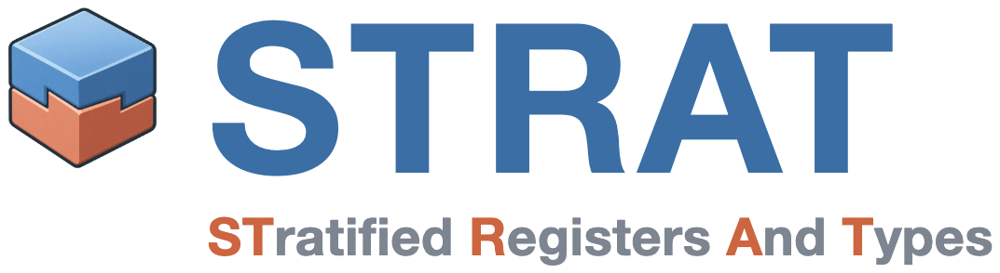
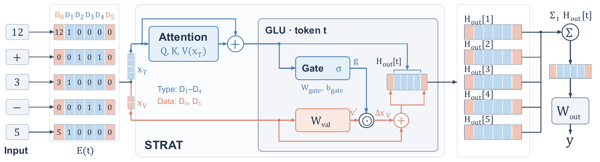

<p align="center">
  
</p>

<h2 align="center">
  The Geometry of Logic: Stratification Induces<br>
  Semantic Structure and Robust Reasoning
</h2>

<p align="center">
  Rethinking the Transformer: separate subspaces for data and control.
</p>

<p align="center">
  
  
  <a href="LICENSE"></a>
</p>

<p align="center">
  <a href="#overview">Overview</a> ·
  <a href="#repository-layout">Repository layout</a> ·
  <a href="#quick-start">Quick start</a>
</p>

## Overview

STRAT partitions the residual stream of a Transformer into two orthogonal subspaces, Data and Type. Attention reads and updates only Type, and a gate conditioned on Type controls every update of Data, so numerical values stay apart from routing decisions. This repository holds the experiments with small STRAT models on arithmetic and logical tasks.

<p align="center">
  
</p>
<p align="center">
  <i>The STRAT block on the arithmetic example 12 + 3 − 5. Type (blue) drives attention and the gate; the gated transform is added back to Data (orange).</i>
</p>

## Repository layout

| Directory | What it does |
|---|---|
| [`hand-coded-alu/`](hand-coded-alu) | A hand-coded arithmetic unit that computes signed sums without training |
| [`dense-failures/`](dense-failures) | An ablation of dense models on the signed-sum task, with probes that measure how each model fails |
| [`lite/`](lite) | STRAT-Lite on the signed-sum task, with a predefined Type and with a learned Type |
| [`efficiency/`](efficiency) | A sample-efficiency sweep in which every model trains on 10 sequences |
| [`multitask/`](multitask) | STRAT and a Transformer baseline on 11 datasets, with the data of every dataset |

## Quick start

The code needs Python 3.10 or later, PyTorch and NumPy; `dense-failures/` also needs pandas, and the SAT datasets in `multitask/` need `pycosat`. Run from the repository root.

```bash
# Hand-coded arithmetic unit on two examples.
python hand-coded-alu/GeomALU_sle.py

# A small run of the ablation, written to its own directory.
python dense-failures/run_ablation.py --configs A Bfl --seeds 5 --out ablation-small

# STRAT-Lite with a predefined Type and with a learned Type.
python lite/strat_lite.py
python lite/strat_lite_learned_types.py

# The sample-efficiency sweep.
python efficiency/driver-efficiency-experiment.py

# STRAT and the Transformer on one dataset, then their ID and OOD accuracy.
bash multitask/run.sh parity5
python -m multitask.evaluate_checkpoints --type-mode onehot --tasks parity5
```

Each directory holds further scripts. [`multitask/README.md`](multitask/README.md) describes the datasets and options.

## License

This repository is released under the GNU General Public License v3.0; see [LICENSE](LICENSE).
